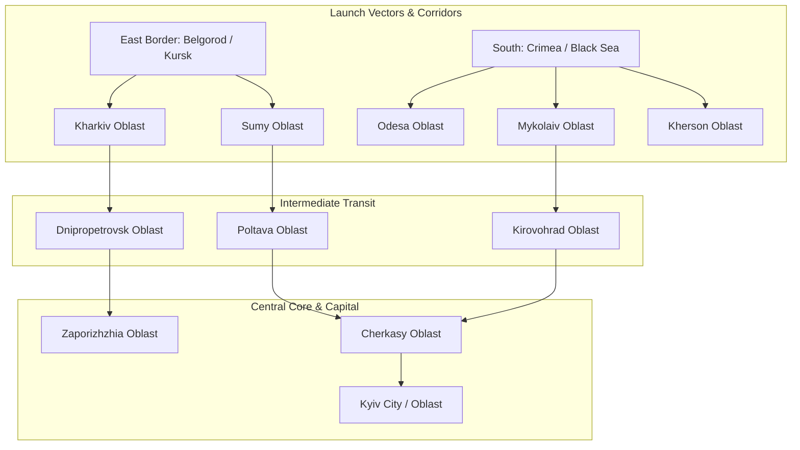
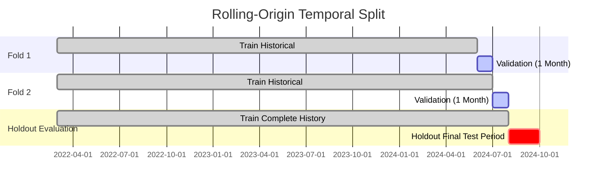

# RESEARCH REPORT & TECHNICAL SPECIFICATION
## Spatio-Temporal Time Series Forecasting of Air Raid Alerts in Ukraine

---

### Executive Summary & Problem Formulation
Air raid alerts across Ukraine constitute a high-stakes, non-stationary spatio-temporal process driven by military logistics, operational doctrines, aerial threat trajectories (cruise/ballistic missiles, Geran/Shahed UAV swarms, tactical aviation glide bombs, MiG-31K sorties), and localized defense reactions.

#### Key Objectives:
1. **Target Formulation**: Region-level binary classification and calibrated probability estimation:
   $$P(\text{Alert}_{r, t \to t+H} = 1 \mid \mathcal{F}_t)$$
   where $r \in \{1, \dots, 25\}$ denotes administrative regions (24 Oblasts + Kyiv City), and $H \in \{1\text{h}, 4\text{h}, 24\text{h}\}$ represents multi-horizon operational windows.
2. **Strict Temporal Integrity (No Data Leakage)**: Ensure that for any forecast generated at point-in-time $t$, all tabular lags, rolling statistics, spatial adjacency signals, and NLP indicators are computed strictly from information available $\le t$.
3. **Multimodal Fusion**: Supplement pure historical alert sequences with text announcements (e.g. Air Force telegram alerts, MiG-31K takeoffs, UAV launch alerts) parsed chronologically.

---

### 1. Data Landscape & Ingestion Architecture

#### 1.1 Alert Sources
- **Historical Archives**:
  - `alerts.in.ua` & `ukrainealarm` archival dumps (e.g. `Vadimkin/ukrainian-air-raid-sirens-dataset`, Kaggle war datasets).
  - Open data endpoints: NEPTUN snapshot stream, JAAM API.
- **Granularity & Entities**:
  - 25 Primary administrative units (24 Oblasts + Kyiv City), extensible to raion (district) level.
  - Timestamp records: `start_time`, `end_time`, `duration_seconds`, `alert_type` (Air Raid, Artillery, Chemical).

#### 1.2 Text / Media Auxiliary Ingestion
- **Official Warning Channels**:
  - Air Force of the Armed Forces of Ukraine (`@kpszsu`).
  - Regional military administrations (`OVA`).
- **Feature Extraction Pipeline**:
  - Regex & Entity Extraction: Keyword detection (`МіГ-31К`, `шахеди / бпла`, `балістика`, `пуск`, `стратегічна авіація Tu-95/160`).
  - Spatial mapping: Parsing mentioned regions/vectors in incoming messages.
  - Event timestamps anchored to publication time ($t_{\text{pub}} \le t_{\text{forecast}}$).

---

### 2. Spatio-Temporal Feature Engineering & Leakage Prevention

#### 2.1 Spatial Graph Representation
Ukraine's oblasts form an undirected geographic adjacency graph $G = (V, E)$, where:
- Nodes $V$: 25 regions.
- Edges $E$: Shared land borders (e.g., Sumy $\leftrightarrow$ Poltava $\leftrightarrow$ Cherkasy $\leftrightarrow$ Kyiv).
- Directional vectors: Inbound threat corridors (North / Belarus corridor, East / Russian border corridor, South / Black Sea & Crimea corridor).

#### 2.2 Feature Dictionary
1. **Autoregressive / Lag Features**:
   - Region alert status at $t$, $t-15\text{m}$, $t-30\text{m}$, $t-1\text{h}$, $t-2\text{h}$, $t-24\text{h}$.
   - Time elapsed since last alert ended in region $r$.
   - Cumulative alert hours in past 6h, 12h, 24h, 7d.
2. **Spatial Lag Features**:
   - Number and percentage of adjacent neighbor oblasts currently on alert.
   - Vector-weighted threat propagation: Alerts active in upstream corridor neighbors.
3. **Temporal & Calendar Features**:
   - Cyclical hour of day: $\sin(2\pi \cdot \text{hour}/24)$, $\cos(2\pi \cdot \text{hour}/24)$ (capturing nocturnal Shahed attack patterns).
   - Day of week, month, day of year.
   - Dark hours / twilight indicators (correlated with drone visibility).
4. **Text / Intelligence Signals**:
   - Indicator for MiG-31K airborne announcement in past 120 minutes (triggers nationwide alert pattern).
   - Ballistic threat warning flagged in past 30 minutes.
   - UAV group launch warning count in past 6 hours.

#### 2.3 Strict Leakage Prevention Rules
- **No Backward Peeking**: Any rolling window computation must have closed right edge at $t$ (e.g., `closed='left'` or strictly lag-1 shifted).
- **Out-of-Time Preprocessing**: Imputation, scaling, target encoding, or frequency mappings must be fit **only** on train partitions and transformed onto validation/test.
- **Duration Leakage**: Under no circumstance should `end_time` or total duration of an alert that began before $t$ and ends after $t$ be known to the feature set. Only the binary state "currently active for $X$ minutes" is allowed.

---

### 3. Model Architecture & Baselines

#### 3.1 Model Hierarchy
1. **Naive Baselines**:
   - **Persistence / Climatology Baseline**: Predicts empirical probability based on hour-of-day and recent historical frequency.
   - **Neighbor-Propagation Baseline**: If any neighbor is active, predict probability $p = f(\text{neighbor count})$.
2. **Tabular Machine Learning Models**:
   - **LightGBM / XGBoost / CatBoost**: Gradient-boosted decision trees trained on flattened spatio-temporal and lag features. Handles non-linear interactions, class imbalance (via scale_pos_weight or focal loss), and missingness natively.
3. **Deep Spatio-Temporal Models**:
   - **Temporal Graph Neural Network (GNN + GRU/LSTM)**: Oblasts as graph nodes, edges as geographic connectivity. Node features evolve over time steps; message passing aggregates upstream alert states.
   - **Multimodal Early/Late Fusion**: Combining tabular lag representations with text embeddings (e.g., multilingual RoBERTa / transformer sentence embeddings of recent Air Force alerts).

---

### 4. Evaluation Strategy & Defense-Centric Metrics

#### 4.1 Temporal Cross-Validation (Rolling-Origin)
To respect real-world sequential deployment, standard k-fold cross validation is strictly prohibited. Instead, a **Rolling-Origin Temporal Split** is implemented:
- **Split 1**: Train on $[T_0, T_{\text{split1}}]$, Validate on $[T_{\text{split1}}, T_{\text{split1}} + \Delta t]$
- **Split 2**: Train on $[T_0, T_{\text{split2}}]$, Validate on $[T_{\text{split2}}, T_{\text{split2}} + \Delta t]$
- **Final Test Set**: The most recent period (e.g., latest 30 to 60 days) reserved as an untouched test set.

#### 4.2 Evaluation Metrics
- **PR-AUC (Precision-Recall Area Under Curve)**: Primary metric due to significant class imbalance (alerts are acute rare-to-moderate events depending on region).
- **ROC-AUC**: Global discriminatory power across discrimination thresholds.
- **Brier Score / Calibration Error**: Crucial for operational defense decision-making; probability estimates must be well-calibrated (a 70% risk must mean 70% frequency of occurrence).
- **Cost-Weighted Utility ($F_{\beta}$ with $\beta=2$)**:
  - In air defense contexts, a False Negative (missed attack, alarm sounded without preparation) carries far higher cost than a False Positive (shelter taken precautionarily).
  - Prioritizes high Recall while maintaining actionable Precision.

---

### 5. Implementation Roadmap

1. **Phase 1: Environment & Dataset Acquisition**:
   - Setup lightweight Python dependencies (`pandas`, `scikit-learn`, `lightgbm`, `geopandas`/adjacency definition).
   - Ingest baseline historical siren dataset and build canonical interval representation.
2. **Phase 2: Data Pipeline & Strict Leakage Guardrails**:
   - Transform interval alerts into regular time-series grid ($\Delta t = 1\text{h}$ or $15\text{m}$).
   - Build spatial neighbor matrix for all 25 Ukrainian administrative entities.
   - Implement temporal sliding-window feature extractor.
3. **Phase 3: Model Training & Multi-Horizon Evaluation**:
   - Benchmark Persistence vs. Logistic Regression vs. LightGBM across 1h, 4h, and 24h horizons.
   - Run rolling-origin validation on the most recent holdout dataset.
4. **Phase 4: Multimodal NLP Extension**:
   - Incorporate parsed text/telegram event indicators (MiG-31K sorties, Shahed alerts).
   - Quantify lift over pure time-series baseline.
