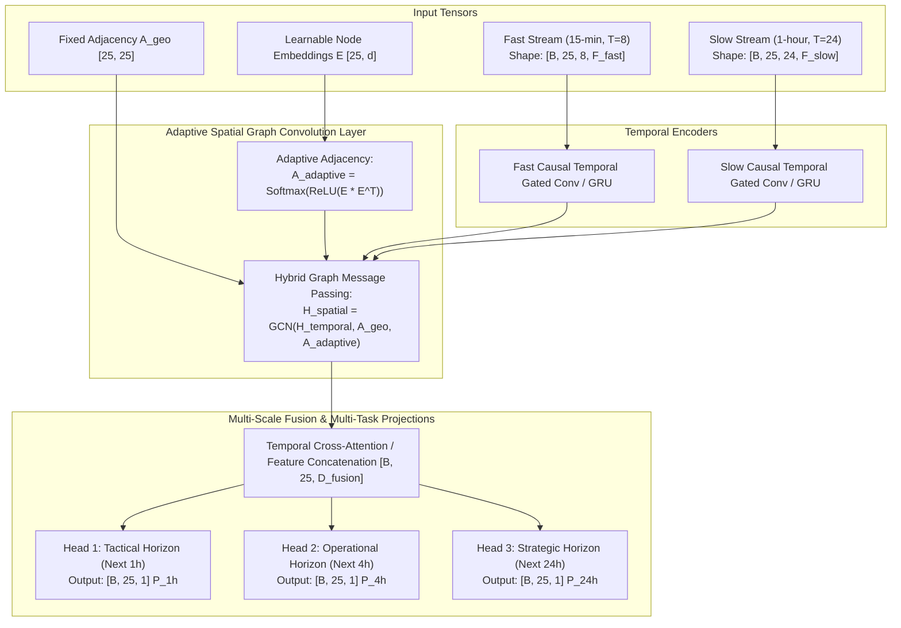

# DEEP LEARNING ARCHITECTURAL SPECIFICATION: MULTI-RESOLUTION SPATIO-TEMPORAL GNN
## Spatio-Temporal Graph Neural Network for Ukrainian Air Raid Alert Forecasting (PyTorch)

---

### Executive Architectural Blueprint
This document defines the professional deep learning architecture, tensor schemas, loss formulations, and PyTorch implementation plan for forecasting air raid alerts across all 25 Ukrainian administrative regions.

Key Specifications:
- **Architecture**: **Hybrid Adaptive Spatio-Temporal Graph Neural Network (Adaptive ST-GNN)**.
- **Hardware Profile**: Designed for training on NVIDIA GeForce RTX 4050 Laptop GPU (6GB VRAM, CUDA 13.1, sm_89) and ultra-fast CPU inference (< 15 ms).
- **Spatial Topology**: **Hybrid Graph Convolution** combining static geographic border adjacency $\mathbf{A}_{\text{geo}}$ with a learnable latent node interaction matrix $\mathbf{A}_{\text{adaptive}}$.
- **Temporal Dynamics**: **Multi-Resolution Dual-Stream Input**:
  - *Stream A (Tactical / Fast)*: High-frequency 15-minute intervals covering the recent 2 hours ($T_{\text{fast}} = 8$ steps).
  - *Stream B (Operational / Slow)*: Hourly aggregated intervals covering the past 24 hours ($T_{\text{slow}} = 24$ steps).
- **Output Heads**: **Unified Multi-Task Head** outputting calibrated threat probabilities simultaneously for $H \in \{1\text{h}, 4\text{h}, 24\text{h}\}$ across all 25 nodes in a single forward pass.

---



---

## 1. Input Tensor Schema & Multi-Resolution Preprocessing

Each training sample at forecast origin $t$ is represented by two synchronized multi-resolution tensors across the $N=25$ regions:

### 1.1 Fast Stream (High-Frequency Tactical Window)
- **Time steps**: $T_{\text{fast}} = 8$ steps (15-min intervals: $t-105\text{m}, t-90\text{m}, \dots, t$).
- **Features per node ($F_{\text{fast}} = 8$)**:
  1. `is_active`: Binary indicator of alert status ($0$ or $1$).
  2. `active_elapsed_ratio`: If active, $\min(\text{duration} / 120\text{m}, 1.0)$, else $0$.
  3. `idle_elapsed_ratio`: If idle, $\min(\text{time\_since\_last\_end} / 360\text{m}, 1.0)$, else $0$.
  4. `active_neighbor_count`: Number of 1st-degree neighbors on alert.
  5. `active_neighbor_ratio`: Fraction of adjacent borders on alert.
  6. `flag_mig31k`: Airborne MiG-31K takeoff announced in past 60 min.
  7. `flag_shahed_group`: Shahed / UAV swarm inbound vector flagged.
  8. `flag_ballistics`: Ballistic missile warning active.
- **Tensor Shape**: $\mathbf{X}_{\text{fast}} \in \mathbb{R}^{B \times 25 \times 8 \times 8}$.

### 1.2 Slow Stream (Macro-Scale Operational Window)
- **Time steps**: $T_{\text{slow}} = 24$ steps (1-hour intervals: $t-23\text{h}, t-22\text{h}, \dots, t$).
- **Features per node ($F_{\text{slow}} = 7$)**:
  1. `alert_active_fraction`: Fraction of the 1-hour window on alert $[0.0, 1.0]$.
  2. `alert_transition_count`: Number of siren triggers during this hour.
  3. `solar_hour_sin`: $\sin(2\pi \cdot \text{hour} / 24)$.
  4. `solar_hour_cos`: $\cos(2\pi \cdot \text{hour} / 24)$.
  5. `day_of_week_sin`: $\sin(2\pi \cdot \text{day} / 7)$.
  6. `day_of_week_cos`: $\cos(2\pi \cdot \text{day} / 7)$.
  7. `rolling_24h_cumulative_hours`: Total alert hours in preceding 24h.
- **Tensor Shape**: $\mathbf{X}_{\text{slow}} \in \mathbb{R}^{B \times 25 \times 24 \times 7}$.

---

## 2. Spatial Graph Architecture: Hybrid Adaptive Adjacency

Standard spatial graphs rely solely on geographic borders ($\mathbf{A}_{\text{geo}}$). However, in aerial warfare, non-neighboring oblasts share strong corridor dependencies (e.g. UAV swarms launching from Crimea transit Kherson and Mykolaiv before striking Vinnytsia or Khmelnytskyi).

### 2.1 The Learnable Adaptive Adjacency
We define a learnable source embedding matrix $\mathbf{E}_1 \in \mathbb{R}^{25 \times d}$ and target embedding matrix $\mathbf{E}_2 \in \mathbb{R}^{25 \times d}$ (where $d = 16$).
The adaptive transition matrix $\mathbf{A}_{\text{adapt}}$ is computed dynamically as:
$$\mathbf{A}_{\text{adapt}} = \text{Softmax}\left(\text{ReLU}\left(\mathbf{E}_1 \mathbf{E}_2^T\right)\right)$$

### 2.2 Hybrid Graph Diffusion
Let $\widetilde{\mathbf{A}}_{\text{geo}} = \mathbf{D}^{-1/2} (\mathbf{A}_{\text{geo}} + \mathbf{I}) \mathbf{D}^{-1/2}$ be the normalized static geographic Laplacian.
The spatial convolution on node representation $\mathbf{H} \in \mathbb{R}^{25 \times C_{\text{in}}}$ evaluates:
$$\mathbf{H}_{\text{spatial}} = \text{ReLU}\left( \widetilde{\mathbf{A}}_{\text{geo}} \mathbf{H} \mathbf{W}_{\text{geo}} + \mathbf{A}_{\text{adapt}} \mathbf{H} \mathbf{W}_{\text{adapt}} + \mathbf{H} \mathbf{W}_{\text{self}} \right)$$
where $\mathbf{W}_{\text{geo}}, \mathbf{W}_{\text{adapt}}, \mathbf{W}_{\text{self}} \in \mathbb{R}^{C_{\text{in}} \times C_{\text{out}}}$ are trainable weight matrices.

---

## 3. Temporal Modeling: Causal Gated TCN / GRU

To strictly enforce **zero data leakage**, the temporal encoders use causal convolutions (dilated 1D convolutions with padding only on the left) or forward unidirectional Gated Recurrent Units (GRU):
- **Fast Stream Encoder**: 1-layer bidirectional or causal 1D GRU with hidden dimension $D_{\text{fast}} = 32$. Extracts high-frequency tactical trajectory.
- **Slow Stream Encoder**: 1-layer causal GRU with hidden dimension $D_{\text{slow}} = 32$. Extracts diurnal and multi-hour attack momentum.

### Multi-Scale Fusion
The representations are fused at node level via an Attention-based Feature Gate:
$$\mathbf{g}_i = \sigma\left(\mathbf{W}_g [\mathbf{h}_{i, \text{fast}} \,\|\, \mathbf{h}_{i, \text{slow}}]\right)$$
$$\mathbf{h}_{i, \text{fused}} = \mathbf{g}_i \odot \mathbf{h}_{i, \text{fast}} + (1 - \mathbf{g}_i) \odot \mathbf{h}_{i, \text{slow}}$$
yielding a unified node state $\mathbf{H}_{\text{fused}} \in \mathbb{R}^{B \times 25 \times 64}$.

---

## 4. Multi-Task Output Projections & Loss Formulation

### 4.1 Multi-Task Prediction Heads
From the fused spatial state $\mathbf{H}_{\text{fused}}$, three dedicated Multi-Layer Perceptrons (MLPs) project logits for each forecasting horizon:
$$\hat{y}_{r, 1\text{h}} = \sigma\left(\text{MLP}_{1\text{h}}(\mathbf{h}_{r, \text{fused}})\right) \in [0, 1]$$
$$\hat{y}_{r, 4\text{h}} = \sigma\left(\text{MLP}_{4\text{h}}(\mathbf{h}_{r, \text{fused}})\right) \in [0, 1]$$
$$\hat{y}_{r, 24\text{h}} = \sigma\left(\text{MLP}_{24\text{h}}(\mathbf{h}_{r, \text{fused}})\right) \in [0, 1]$$

### 4.2 Cost-Sensitive Focal Loss ($L_{\text{multi}}$)
Because air alerts are imbalanced (positives are rare in central/western oblasts during lulls) and missing an attack carries high defense consequences, standard Binary Cross-Entropy is augmented with **Focal Loss with Asymmetric False-Negative Penalty**:

$$\mathcal{L}_H = - \frac{1}{N} \sum_{r=1}^{N} \left[ \alpha \cdot y_r (1 - \hat{p}_r)^\gamma \log(\hat{p}_r) + (1 - \alpha) \cdot (1 - y_r) \hat{p}_r^\gamma \log(1 - \hat{p}_r) \right]$$
with $\gamma = 2.0$ and $\alpha = 0.75$ (biasing gradients to penalize False Negatives).

Total training loss is a weighted multi-task sum:
$$\mathcal{L}_{\text{total}} = 1.0 \cdot \mathcal{L}_{1\text{h}} + 0.8 \cdot \mathcal{L}_{4\text{h}} + 0.5 \cdot \mathcal{L}_{24\text{h}} + \lambda_{\text{reg}} \|\mathbf{A}_{\text{adapt}}\|_F$$

---

## 5. PyTorch Implementation Plan & Code Architecture

We organize the codebase into modular, production-ready Python files:

```
src/
├── data/
│   ├── download_alerts.py     # Pulls official_data_uk.csv from GitHub archive
│   ├── build_graph.py         # Constructs binary adjacency matrix A_geo for 25 oblasts
│   ├── multi_res_dataset.py   # Sliding-window dataset generator (15m fast + 1h slow)
│   └── text_features.py       # Compiled regex tactical intelligence flag parser
├── models/
│   ├── layers.py              # Adaptive Graph Convolution & Temporal Causal GRU
│   ├── st_gnn.py              # PyTorch Multi-Resolution ST-GNN Module
│   └── loss.py                # Multi-Task Cost-Sensitive Focal Loss
├── training/
│   ├── train_rolling.py       # Rolling-origin temporal training engine with RTX 4050 AMP
│   └── evaluate.py            # PR-AUC, ROC-AUC, Brier score, and F2 utility evaluation
└── inference/
    ├── predict_engine.py      # Real-time sub-15ms inference runner
    └── export_onnx.py         # ONNX exporter for micro-VPS CPU deployment
```

### Hardware Verification & Optimization
- **GPU**: NVIDIA GeForce RTX 4050 Laptop GPU (6GB VRAM, sm_89).
- **Precision**: PyTorch `torch.amp.autocast(device_type='cuda', dtype=torch.float16)` for $2.5\times$ speedup and low memory usage during training.
- **Batch Size**: $B = 64$ fits comfortably within $< 2\text{ GB}$ VRAM.
