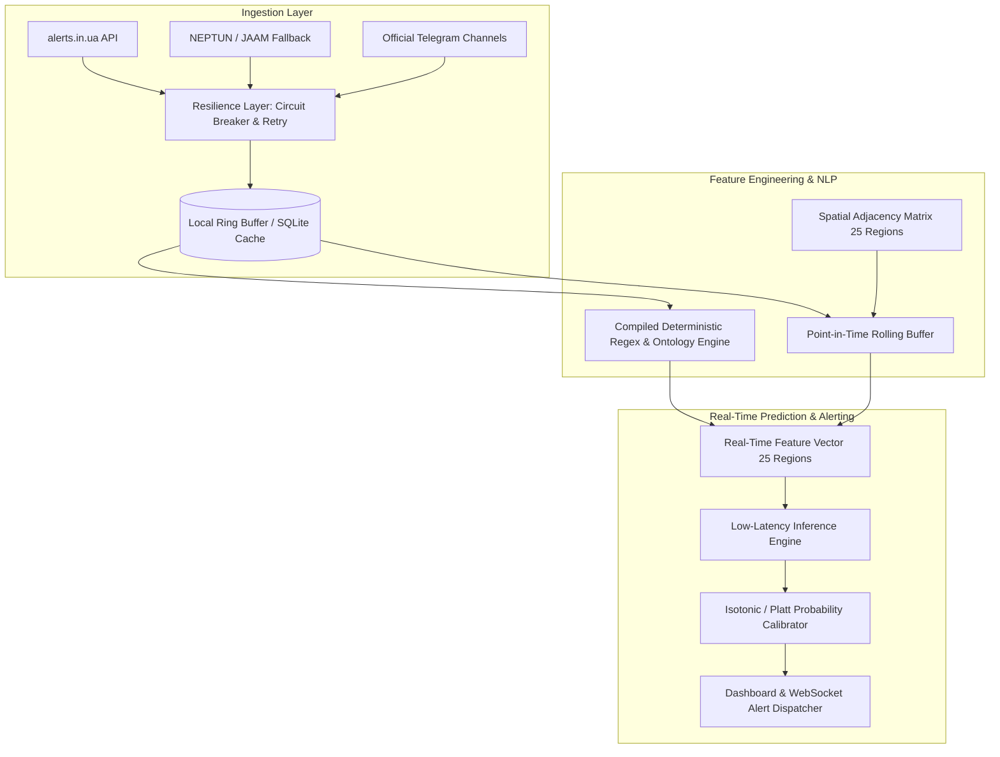

# TECHNICAL CHALLENGES, PIPELINE RISKS & PRODUCTION COST-EFFICIENCY RESEARCH
## Operational Real-Time Defense Forecasting System for Ukrainian Air Raid Alerts

---

### Executive Product & Engineering Context
This document assesses the pipeline bottlenecks, architectural hazards, technical challenges, and production cost trade-offs for deploying a **real-time air raid alert early-warning system and dashboard** covering all 25 administrative regions of Ukraine.

Target Specifications:
- **Operating Scenario**: Real-time operational dashboard & warning system with sub-second end-to-end inference latency.
- **Update Cadence**: Streaming / event-driven polling updates every 1 to 5 minutes.
- **Compute Philosophy**: Zero reliance on expensive, high-latency external LLMs in production; maximum CPU/cost-efficiency using deterministic parsing and optimized lightweight inference pipelines.

---

---

## 1. Data Pipeline Failures & Operational Challenges

### 1.1 Upstream API Downtime, Rate Limits & Blackouts
* **The Challenge**: During massive missile/drone strikes, public and volunteer alert APIs experience traffic spikes (DDOS-like loads) and power/infrastructure disruptions. API calls can hang, return HTTP 429 (Rate Limited), 502/504, or fail completely.
* **Failure Impact**: If the ingestion worker blocks synchronously, the entire pipeline freezes, missing subsequent alert state changes.
* **Product-Grade Solution**:
  - **Multi-Source Failover Circuit Breaker**: Primary REST endpoint (`alerts.in.ua`) with automated fallback to secondary mirror (`NEPTUN`, `JAAM`) upon 3 consecutive timeouts.
  - **Local In-Memory Ring Buffer + SQLite WAL Mode**: Decouple ingestion from feature calculation. The ingestion thread updates an in-memory buffer; even if external internet drops for several minutes, the prediction pipeline continues operating on known system states without crashing.
  - **Exponential Backoff with Jitter**: Avoid thundering herd problem during service restoration.

### 1.2 Clock Drift, Event Out-of-Order Delivery & Timestamp Misalignment
* **The Challenge**: Alert timestamps emitted across different APIs and Telegram message timestamps can exhibit clock skews (seconds to a couple of minutes). Additionally, an "alert ended" message can arrive out-of-order due to network retries.
* **Failure Impact**: Negative alert durations, alerts ending before they begin, or feature leakage where future alert terminations leak into the current time window.
* **Product-Grade Solution**:
  - **Monotonic Event Sequence Processing**: Enforce server-side UTC timestamps paired with logical event watermarks.
  - **Sanitization Invariant Checks**: Drop/clamp contradictory events (e.g. if an `alert_end` has timestamp $< \text{alert\_start}$, flag as anomaly and clamp to current ingest time).

### 1.3 Label Asymmetry & Concept Drift Between War Phases
* **The Challenge**: The nature of air raid alerts has changed drastically over the conflict:
  - *2022*: Long-range cruise missiles, multi-day nationwide sirens.
  - *2023-2024*: Massive nocturnal Shahed/Geran drone swarms with 6-8 hour staggered loitering times; frequent MiG-31K patrols (short 20-30 min alerts).
  - *2024-2026*: Ballistic threats from border oblasts with minimal warning time (sub-5 minutes) combined with daily frontline glide-bombing (KABs).
* **Failure Impact**: A model trained uniformly on historical 2022-2023 data will severely mispredict current strike patterns and alert durations.
* **Product-Grade Solution**:
  - **Time-Decayed Weighting or Sliding Training Windows**: Prioritize the most recent 3–6 months for model retraining.
  - **Continuous Concept Drift Monitoring**: Track rolling Brier score and False Discovery Rate (FDR) continuously. If rolling performance drops below baseline threshold, trigger an automated retrain workflow.

---

## 2. Text/Media Pipeline Challenges (Zero-LLM Architecture)

### 2.1 The Pitfalls of Using LLMs in Production
* **Cost & Compute Explosion**: Making LLM calls (e.g., GPT-4o, Claude, or local 7B models) every 1–2 minutes across 5-10 Telegram channels amounts to thousands of calls per day, accumulating steep API bills or requiring expensive dedicated GPU instances ($200–$800+/month).
* **Latency Bottleneck**: LLM API calls take 800ms–3500ms and are prone to rate limits, violating the strict sub-second real-time latency requirement.
* **Nondeterministic Parsing**: LLM hallucinations or JSON formatting errors can inject erratic signals into mission-critical alert vectors.

### 2.2 The Deterministic Alternative: Compiled Regex & Keyword Ontology
* **Architecture**: A pure Python/Rust compiled regular expression engine paired with a domain-specific military lexicon:
  - **Tactical Entities**: `МіГ-31К`, `Кинжал`, `Шахед/Герань`, `БпЛА`, `балістика`, `пуск`, `Ту-95МС`, `КАБ`.
  - **Geographic Vectors**: Matching oblast names, cardinal directions (`з півдня`, `через Сумщину на Полтавщину`), and specific coordinates.
* **Performance Profile**:
  - **Execution Latency**: $< 0.8\text{ ms}$ per Telegram post.
  - **Hardware Footprint**: Negligible (runs on standard single-core CPU, microsecond RAM usage).
  - **Financial Cost**: **$0.00 / month**.
  - **Reliability**: 100% deterministic and unit-testable.

### 2.3 Challenges in Deterministic Text Parsing
* **Slang, Typos & Evolving Jargon**: Military Telegram channels frequently update codenames and colloquial phrasing (e.g., `мопеди`, `бляшанки`, `тушки`, `небезпека по балістиці`).
* **Negation & Retraction Ambiguity**: Announcements like `"Відбій загрози МіГ-31К"` vs `"Зафіксовано зліт МіГ-31К"`.
* **Mitigation**:
  - Strict pattern matching with negative lookbehinds/lookaheads (e.g., `(?<!відбій\s)(зліт|активність)\s+міг-31к`).
  - Separation of message classes into `ThreatSpawn`, `ThreatUpdate`, and `ThreatClearance`.

---

## 3. Real-Time Feature Store & State Management Challenges

### 3.1 Avoiding Data Leakage in Streaming vs. Offline Parity
* **The "Training-Serving Skew" Hazard**: In offline model training, features are computed via vectorized pandas rolling windows. In production, features must be computed sequentially at arrival time $t$. If the rolling calculation differs by even 1 millisecond or handles edge boundary conditions differently, inference quality degrades.
* **Leakage Pitfall**: Accidentally utilizing alert completion times (`duration` or `end_time`) when generating features at point-in-time $t$ for currently active sirens.
* **Engineering Solution**:
  - **Unified Feature Transformation Module**: The exact same class/module calculates features for both batch datasets (by iterating temporal slices) and live streaming vectors.
  - **Point-in-Time State Engine**: At time $t$, the state of region $r$ is strictly bounded by:
    $$\text{State}(r, t) = \{\text{active\_since}: t - t_{\text{start}}, \text{is\_active}: 1\} \quad \text{if } t_{\text{start}} \le t < t_{\text{end}} \text{ else } \{\text{idle\_since}: t - t_{\text{last\_end}}, \text{is\_active}: 0\}$$
    The value $t_{\text{end}}$ is strictly unobservable to the feature extractor if $t_{\text{end}} > t$.

### 3.2 Spatio-Temporal Graph State Synchronization
* **The Challenge**: Alerts in Ukraine propagate geographically (e.g. Shahed drones traveling from South/East borders through central corridors toward western regions). Calculating spatial graph metrics (e.g., active neighbors, upstream corridor pressure) for all 25 regions at high frequency can incur quadratic computational overhead if implemented naively.
* **Engineering Solution**:
  - Pre-computed static **Binary Adjacency Matrix** $A \in \{0, 1\}^{25 \times 25}$ in memory.
  - Matrix multiplication: $\mathbf{n}_{\text{active}} = A \mathbf{x}_t$ where $\mathbf{x}_t \in \{0, 1\}^{25}$ is the instantaneous state vector. This operation takes $< 5 \ \mu\text{s}$ using NumPy.

---

## 4. Evaluation & Production Monitoring Hazards

### 4.1 Extreme Class Imbalance & Metric Deception
* **The Trap**: In western oblasts (e.g., Zakarpattia, Chernivtsi), alerts may occur only 2-5% of total hours. A naive model predicting constant zero achieves 95-98% accuracy while being completely useless for defense warnings.
* **Production Risk**: High false-alarm rates cause "alert fatigue" (civilians ignore warnings), while false negatives cause severe life-safety casualties.
* **Engineering Solution**:
  - Optimize for **PR-AUC (Precision-Recall Area Under Curve)** and **Cost-Utility Metric ($F_2$-score)** rather than Accuracy or Raw Loss.
  - Apply **Isotonic Regression / Platt Scaling** to ensure raw model scores represent true empirical probabilities.

### 4.2 Latency vs. Accuracy Trade-Offs Matrix

| Component | Pure LLM Approach | Hybrid Neural | Proposed Production Pipeline (Regex + Lean Model) |
| :--- | :--- | :--- | :--- |
| **NLP Text Parsing Latency** | 1,200 ms – 3,500 ms | 15 ms – 30 ms (MiniLM) | **< 1 ms (Compiled Regex)** |
| **Feature Extraction (25 regions)** | N/A | 10 ms | **< 2 ms (NumPy Matrix Ops)** |
| **End-to-End Inference Latency** | > 2,000 ms | 40 ms – 70 ms | **< 10 ms** |
| **Monthly Cloud Compute Cost** | \$300 – \$1,200 (API/GPU) | \$80 – \$200 (GPU/Heavy CPU) | **\$5 – \$15 (Standard Tiny VPS / Micro VM)** |
| **Downtime / Quota Risk** | High (third-party API) | Low (Self-hosted) | **Zero (100% self-contained)** |

---

## 5. Development Milestones & Verification Safeguards

To prevent pipeline regression during implementation, the system must enforce four architectural guardrails:

1. **Leakage Unit Tests**: Automated synthetic test cases where future events are artificially injected into historical logs; tests verify that feature vectors at time $t$ remain strictly bit-for-bit identical regardless of future records.
2. **Offline-Online Parity Assertion**: Run the live streaming feature extractor over a historical replay stream and assert zero numerical divergence against the batch dataset generator.
3. **Network Resiliency Simulation**: Synthetic chaos testing simulating 15-minute REST API blackouts to verify that the local fallback cache and prediction bus recover without crashes or memory leaks.
4. **Standalone Research Session for Inference Engines**: Dedicate an isolated benchmark session to evaluate model candidates (LightGBM vs. CatBoost vs. Linear Ridge vs. Spatio-temporal GNN) on CPU latency, memory footprint, and PR-AUC.
