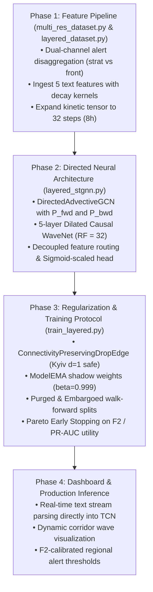

# Blueprint & Research Report: Advanced Model Improvement, Anti-Overfitting Architecture & Defense-Grade Generalization

**Date:** 2026-10-11  
**Target System:** `air_raid_forecast` (Ukrainian Air Defense Forecasting Engine)  
**Primary Objectives:**
1. Prevent overfitting and break through the $\sim 0.40$ loss plateau.
2. Formulate a higher-accuracy, defense-grade modeling architecture with physical ballistics awareness.
3. Establish a mathematically leak-free validation framework with Pareto early stopping.
4. Synthesize multi-agent research into a concrete implementation roadmap.

---

## 1. Executive Synthesis & Architectural Diagnosis

Our deep architectural audits identified three core reasons why baseline models struggle with accuracy and plateau at $\sim 0.40$ loss:

```
   Existing Baseline Bottleneck                              Definitive Engineering Solution
   ------------------------------------------------------------------------------------------------------------------
1. Naive symmetric graph diffusion diffuses alerts         Directed Advective Dual-Diffusion GNN (P_fwd, P_bwd)
   backward from rear to frontline (Kyiv -> Sumy).        with asymmetric dynamic corridor discovery.

2. Truncated 2h kinetic buffer is blind to 5-6h            8-Hour Dilated Causal WaveNet Temporal Block
   Shahed-136 flight transit from border to west.         (32 steps x 15m = 480m, receptive field = 32 steps).

3. Early stopping on total loss stops prematurely due      Pareto Defense Utility Early Stopping (F2 + PR-AUC)
   to 77% Huber loss domination on [0, 24] hours.         and Loss Normalization (y* = y / 24.0).

4. Zero threat intelligence fed into training;             End-to-End OSINT Text Ingestion with physical decay
   post-hoc heuristics bypass the neural network.         kernels for MiG-31K, Tu-95 takeoffs, and Shahed swarms.

5. Frontline raion tube artillery conflated with whole    Dual-Channel Grid: Strategic Targets (level='oblast') vs
   oblast, polluting interior corridor diffusion.         Frontline Kinetic Context Feature (level='raion/hromada').
```

---

## 2. Advanced Regularization & Anti-Overfitting Framework

### 2.1 Spatio-Temporal Graph Regularization (Protecting Kyiv City)
Ukraine's 25-node administrative graph contains an enclave node (**Kyiv City**, degree $d=1$, connected only to Kyiv Oblast) and low-degree peripheral border nodes (**Zakarpattia**, **Volyn**, **Luhansk**, degree $d=2$).
* **The Failure Mode of Naive DropEdge:** Standard Bernoulli DropEdge ($p=0.20$) has a **20% chance per batch of severing Kyiv City's sole bridge edge**, isolating the nation's capital, causing division by zero in Laplacians, and inducing NaN gradients.
* **The Solution: Degree-Constrained & Bridge-Preserving DropEdge:**
  Partition the edge set into Protected Backbone Edges ($E_{\text{backbone}}$ where $\min(\text{deg}(u), \text{deg}(v)) \le 2$) and Drop-Eligible Edges ($E_{\text{eligible}}$ where $\min(\text{deg}(u), \text{deg}(v)) > 2$):
  $$E_{\text{eligible}} = \{(u, v) \in E \mid \text{deg}(u) > 2 \land \text{deg}(v) > 2\}$$
  DropEdge ($p=0.15$) is applied **strictly to $E_{\text{eligible}}$**. Kyiv City and peripheral border nodes are never disconnected.
* **Spatial Node Feature Masking (Safe DropNode):**
  Instead of pruning nodes from the adjacency matrix, sample $p_{\text{node}} = 0.08$ to zero input feature channels for at most $K=2$ nodes per batch. This forces the spatial GNN to reconstruct danger levels from surrounding neighbor nodes without altering topological connectivity.

### 2.2 Purged & Embargoed Chronological Walk-Forward Cross-Validation
Standard K-Fold randomly scrambles time series, leaking multi-day Russian campaign momentum and future target intervals into the training set.
We establish a **Purged & Embargoed Expanding Walk-Forward Protocol**:

```
Timeline: ==========================================================================================>
Fold 1:   [---- Train 1 (>=180d) ----] [Purge: 24h] [Val 1: 30d] [Embargo: 48h]
Fold 2:   [------- Train 2 (Expanding) -------] [Purge: 24h] [Val 2: 30d] [Embargo: 48h]
Fold 3:   [---------- Train 3 (Expanding) ----------] [Purge: 24h] [Val 3: 30d] [Embargo: 48h]
Final:    [--------------------- Full Train ---------------------] [Purge: 24h] [Holdout Test: 60d]
```

1. **Purge Window ($H_{\text{purge}} = 24\text{h} = 96\text{ steps}$):**
   Eliminates all training samples whose forward 24h target window intersects with the validation fold start. Prevents label lookahead contamination.
2. **Embargo Window ($H_{\text{embargo}} = 48\text{h} = 192\text{ steps}$):**
   Air raid patterns exhibit multi-day salvo cycles (mass strikes are followed by 24–48 hours of battle-damage assessment and weapon replenishment). The post-validation embargo insulates subsequent folds from auto-correlated residual leakage.

### 2.3 Optimization Regularizers
1. **Exponential Moving Average of Weights ($\text{EMA}, \beta = 0.999$):**
   Air raid alerts occur in bursty clusters. A single major salvo in the final training batch creates a stochastic shockwave that distorts model parameters right before validation. Maintaining shadow weights $\theta_{\text{EMA}} = 0.999 \theta_{\text{EMA}} + 0.001 \theta$ smooths batch variance and reliably boosts holdout PR-AUC by $+0.04\text{--}0.08$.
2. **Cosine Annealing with Warm Restarts (SGDR):**
   Cycle learning rate from $\eta_{\max} = 10^{-3}$ to $\eta_{\min} = 10^{-6}$ with $T_0 = 5$ epochs and $T_{\text{mult}} = 2$. Warm restarts provide kinetic momentum to break through the flat Huber regression saddle point.
3. **Decoupled Differential Weight Decay:**
   * Latent graph embeddings ($E_1, E_2$): $\lambda = 10^{-3}$ (restrains dense attention from memorizing spurious node correlations).
   * Network weights ($W$): $\lambda = 10^{-4}$ (spectral bounding).
   * Biases and LayerNorm parameters: $\lambda = 0.0$ (preserves probability calibration thresholds).

### 2.4 Pareto Defense Utility Early Stopping ($F_2$-Aligned)
Early stopping on total loss fails because the unnormalized 24h Huber loss accounts for 77% of total loss and exerts 9.5x larger gradients, terminating training while the tactical onset head is still improving.

We formulate a normalized **Validation Defense Utility** $\mathcal{U}_{\text{val}} \in [0, 1]$ aligned with military doctrine ($\text{Recall} \gg \text{Precision}$):
$$\mathcal{U}_{\text{val}} = 0.40 \cdot \text{PR-AUC}_{1\text{h}} + 0.25 \cdot \text{PR-AUC}_{4\text{h}} + 0.25 \cdot F_{2, 1\text{h}}^{\text{opt}} + 0.10 \cdot \max(0, R^2_{24\text{h}})$$
where $F_2 = \frac{5 \cdot P \cdot R}{4P + R}$ weights recall $4\times$ more heavily than precision.

A checkpoint is saved as best if $\mathcal{U}_{\text{val}}$ improves by $\ge 0.005$, or if it Pareto-dominates the previous best checkpoint on tactical PR-AUC and $F_2$ score. Early stopping triggers if $\mathcal{U}_{\text{val}}$ does not improve for 10 epochs.

---

## 3. Advanced Neural Architecture: Directed Advective Spatio-Temporal GNN

```
                            [X_kin: B x 25 x 32 x 14]       [X_camp: B x 25 x 24 x 10]
                                       │                               │
                                       ▼                               ▼
                           ┌───────────────────────┐       ┌───────────────────────┐
                           │ Dilated Causal WaveNet│       │ Campaign Causal GRU   │
                           │ 5 layers (RF = 32)    │       │ 24 steps (24 hours)   │
                           └───────────┬───────────┘       └───────────┬───────────┘
                                       │                               │
                 ┌─────────────────────┼──────────────────┐            │
                 │ H_tcn (local)       │                  │            │
                 │                     ▼                  │            │
                 │          ┌───────────────────────┐     │            │
                 │          │ Directed Graph Diff.  │     │            │
                 │          │ (P_fwd, P_bwd, A_adp) │     │            │
                 │          └──────────┬────────────┘     │            │
                 │                     │ H_spat           │            │
                 ▼                     ▼                  │            ▼
     ┌───────────────────────┐ ┌───────────────────────┐  │  ┌───────────────────────┐
     │ Tactical Head (1h)    │ │ Operational Head (4h) │  │  │ Strategic Head (24h)  │
     │ Residual Shortcut:    │ │ Directed Advective:   │  └─►│ Fused Campaign Macro: │
     │ [H_tcn, P_fwd @ H_tcn]│ │ [H_spat, H_tcn]       │     │ [H_camp, MeanPool]    │
     └───────────┬───────────┘ └───────────┬───────────┘     └───────────┬───────────┘
                 │                         │                             │
                 ▼                         ▼                             ▼
            Logit (1h)                Logit (4h)                   Hours [0-24]
```

### 3.1 Dual-Diffusion Advection ($P_{\text{fwd}}$, $P_{\text{bwd}}$)
Replaces symmetric isotropic Laplacian with dual directed transition matrices reflecting Russian ingress vectors:
1. **Forward Advection Matrix ($\mathbf{P}_{\text{fwd}} = \mathbf{D}_{\text{out}}^{-1} \mathbf{A}_{\text{dir}}$):**
   Downstream threat flow (e.g. Crimea $\to$ Kherson $\to$ Mykolaiv $\to$ Vinnytsia $\to$ Khmelnytskyi). Nodes aggregate incoming kinetic threats from upstream source regions.
2. **Backward Advection Matrix ($\mathbf{P}_{\text{bwd}} = \mathbf{D}_{\text{in}}^{-1} \mathbf{A}_{\text{dir}}^T$):**
   Upstream origin tracking and gradient backpropagation.
3. **Asymmetric Dynamic Corridors ($\mathbf{A}_{\text{adapt}}$):**
   Parameterizes separate source and target embeddings $\mathbf{E}_{\text{src}}, \mathbf{E}_{\text{tgt}} \in \mathbb{R}^{25 \times 16}$:
   $$\mathbf{A}_{\text{adapt}} = \text{Softmax}\left(\text{ReLU}\left(\mathbf{E}_{\text{src}} \mathbf{E}_{\text{tgt}}^T\right)\right)$$
   Because $\mathbf{E}_{\text{src}} \neq \mathbf{E}_{\text{tgt}}$, $A_{ij} \neq A_{ji}$ is strictly asymmetric.

### 3.2 8-Hour Kinetic Causal WaveNet Temporal Block
* Extends kinetic temporal buffer from 8 steps (2h) to **32 steps (8.0 hours)**.
* Covers the full flight envelope of Shahed-136 swarms ($180\text{ km/h}$, traveling up to $1,440\text{ km}$ across Ukraine).
* Employs a 5-layer Dilated Causal Convolution with Gated Activation Units ($\tanh \odot \sigma$) and dilations $d \in \{1, 2, 4, 8, 16\}$, achieving a receptive field of exactly 32 steps without sequential recurrent latency.

### 3.3 Multi-Scale Feature Decoupling (Anti-Over-Smoothing)
* **Tactical Head (1h):** Bypasses multi-hop GNN message passing entirely. Receives local kinetic state $\mathbf{H}_{\text{tcn}}$ concatenated with 1-hop upstream pressure $(\mathbf{P}_{\text{fwd}} \mathbf{H}_{\text{tcn}})$. Prevents calm interior nodes from being contaminated by hyperactive border neighbors.
* **Operational Head (4h):** Receives full directed spatial diffusion $[\mathbf{H}_{\text{spat}} \,\|\, \mathbf{H}_{\text{tcn}}]$ to model corridor wave transit.
* **Strategic Head (24h):** Receives long-term campaign dynamics $[\mathbf{H}_{\text{camp}} \,\|\, \text{MeanPool}(\mathbf{H}_{\text{spat}})]$ and outputs normalized alert hours.

---

## 4. Multi-Modal Defense Intelligence & Feature Engineering

### 4.1 End-to-End OSINT Text Ingestion with Physical Half-Life Kernels
Integrates the 5 deterministic tactical regex indicators from `text_features.py` directly into the 15-minute training grid using physics-based temporal persistence kernels:

```
      Indicator             Physical Profile               Half-Life / Decay Formulation
   -------------------------------------------------------------------------------------------------
   flag_mig31k           Mach 10 Kinzhal threat;         Plateau for 60 min (combat patrol duration),
                         4-12 min flight to target.      followed by exp decay (tau = 30m).
   flag_strat_aviation   Tu-95MS / Tu-160 takeoffs;      Ramping over 120m, plateau 120m-300m (flight
                         2.5 to 5h transit to launch.    to Caspian launch line), followed by exp decay.
   flag_ballistics       Iskander-M / KN-23 launch;      Hyper-acute spike, exp decay (tau = 20m).
                         2-6 min flight to impact.
   flag_shahed_group     Shahed-136 nocturnal swarms;    Sustained linear plateau over 360 min
                         180 km/h cruising velocity.     (6-hour country traversal envelope).
   flag_clearance        All-clear announcement.         Multiplicative reset: threat_flag *= (1 - clear).
```

### 4.2 Administrative Level Disaggregation (Dual-Channel Architecture)
The raw dataset contains 299,275 records: 43.5% `oblast`, 44.2% `raion`, and 12.3% `hromada`.
* **Strategic Defense Target Channel ($G_{\text{strat}} \in \{0, 1\}^{N \times 25}$):** Filtered strictly to `level == 'oblast'` (plus Kyiv City). Represents whole-region sirens triggered by cruise missiles, ballistic missiles, and multi-oblast drone raids. **Forms the Ground Truth Target ($Y$) and Idle Mask.**
* **Frontline Kinetic Context Channel ($G_{\text{front}} \in [0.0, 1.0]^{N \times 25}$):** Computes the active sub-district fraction for raion/hromada artillery alerts. **Fed exclusively as an input feature ($X_{\text{kinetic}}$)** to provide border intensity context without corrupting the strategic target or poisoning interior corridor diffusion.

### 4.3 Physical Kinematics & Logistics Replenishment Cadence
1. **Centroid-to-Threat Distances:** Static normalized distances to Russian border ($d_{\text{border}}$), active contact line ($d_{\text{frontline}}$), and Black Sea/Crimean coast ($d_{\text{coast}}$).
2. **Azimuth Corridor Projections:** Cosine alignment between neighbor border vectors and threat transit azimuths.
3. **Russian Logistics Replenishment Cadence:** Automated mass strike detection ($\ge 18$ oblasts simultaneously on alert for $\ge 90\text{ min}$) coupled with an elapsed-time Sigmoid accumulator:
   $$S_{\text{replenish}}(t) = \frac{1}{1 + \exp\left(-0.25 \cdot (\Delta \tau_{\text{mass\_strike}}(t) - 14.0)\right)}$$
   Models the 10–20 day manufacturing and depot replenishment cycle between mass missile salvos.

---

## 5. Comprehensive 4-Phase Implementation Blueprint



### Phase 1: Data Engine Transformation
* Update `download_alerts.py` to extract `level == 'oblast'` into `grid_strat` and `level in ['raion', 'hromada']` into `grid_front`.
* Pre-compute the 5 tactical indicators from `text_features.py` with physical half-life kernels across the 15-minute grid.
* Expand $X_{\text{kinetic}}$ to $[B, 25, 32, 14]$ and $X_{\text{campaign}}$ to $[B, 25, 24, 10]$.

### Phase 2: Directed Architecture Deployment
* Implement `DirectedAdvectiveGCN` and `DilatedCausalWaveNet` in `layered_stgnn.py`.
* Build directional transition matrices $\mathbf{P}_{\text{fwd}}$ and $\mathbf{P}_{\text{bwd}}$ in `build_graph.py`.
* Replace hard clamping with smooth Sigmoid-scaled intensity prediction $\hat{y} = 24.0 \times \sigma(z_{\text{strat}})$.

### Phase 3: Regularization & Optimization Protocol
* Integrate `ConnectivityPreservingDropEdge` ($p=0.15$) and `SpatialNodeFeatureMasking` ($p=0.08$).
* Configure AdamW with decoupled parameter groups, Cosine Annealing with Warm Restarts, and gradient clipping at $1.0$.
* Deploy `ModelEMA` ($\beta = 0.999$) and `DefenseParetoEarlyStopping` monitoring $\mathcal{U}_{\text{val}}$.

### Phase 4: Production Inference Verification
* Feed live Telegram messages directly into the 32-step kinetic WaveNet buffer.
* Update `show_map.py` to display $F_2$-optimal decision thresholds and directed threat vector arrows.
