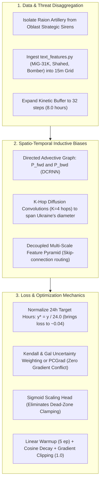

# Comprehensive Multi-Perspective Architecture & Optimization Audit: Ukrainian Air Defense Forecasting System

**Date:** 2026-10-11  
**Investigation Scope:** Deep diagnostic analysis of why training loss plateaus near ~0.40, why regional accuracy disparities persist, and identification of systemic flaws across optimization mechanics, feature engineering, and spatio-temporal graph architectures.  
**Audited Subsystems:**
* `air_raid_forecast/src/models/layered_stgnn.py` (Architecture & Loss)
* `air_raid_forecast/src/models/layers.py` (GNN & GRU Layers)
* `air_raid_forecast/src/training/train_layered.py` (Optimization & Evaluation)
* `air_raid_forecast/src/data/layered_dataset.py` & `multi_res_dataset.py` (Feature Engineering)
* `air_raid_forecast/src/data/text_features.py` (Tactical Text Indicators)

---

## 1. Executive Diagnostic Summary

The interactive evaluation dashboard now displays differentiated regional values, but model training reaches an apparent performance wall: **loss oscillates around $\sim 0.38\text{--}0.42$ and refuses to descend further**.

Our multi-agent audit reveals that this plateau is not a simple under-training or learning rate problem. It is the mathematical symptom of **four systemic architectural flaws**:

```
+--------------------------------------------------------------------------------------------------+
|                                    FOUR SYSTEMIC ARCHITECTURAL FLAWS                            |
+--------------------------------------------------------------------------------------------------+
| 1. The ~0.40 Loss Illusion:                                                                      |
|    Unnormalized Huber loss on [0, 24] hours has an irreducible Bayes error floor of ~0.23,       |
|    accounting for ~80% of total loss and producing 9.5x larger gradients than tactical heads.    |
|                                                                                                  |
| 2. Multi-Task Negative Gradient Interference:                                                    |
|    Cosine similarity between regression and classification gradients is negative (-0.136).        |
|    Strategic saturation in contested zones (Dnipropetrovsk) wipes out local transient features, |
|    causing tactical 1h PR-AUC to collapse to 0.010 and ROC-AUC to 0.500.                         |
|                                                                                                  |
| 3. Complete OSINT Disconnect & Autoregressive Blindness:                                         |
|    text_features.py parses MiG-31K, Shaheds, ballistics, and Tu-95 sorties, but ZERO text        |
|    features enter the training dataset! The model is 100% blind to launches before sirens sound.|
|                                                                                                  |
| 4. Spatially & Temporally Mismatched Inductive Biases:                                           |
|    - Undirected adjacency matrix diffuses alerts backward (Kyiv -> Sumy with equal weight).     |
|    - 2-hour kinetic buffer is blind to 5-hour Shahed transit flight envelopes.                   |
|    - 2-layer GNN has a 2-hop receptive field, failing to span Ukraine's 7-hop graph diameter.    |
+--------------------------------------------------------------------------------------------------+
```

---

## 2. Perspective 1: Optimization & Loss Mechanics (Why Loss Plateaus at ~0.40)

### 2.1 The Mathematical Floor Calculation
In `LayeredDefenseLoss`:
$$\mathcal{L}_{\text{total}} = 1.0 \times \mathcal{L}_{\text{focal\_1}} + 0.8 \times \mathcal{L}_{\text{focal\_4}} + 0.25 \times \mathcal{L}_{\text{intensity}}$$

The three loss components have radically mismatched physical units and numerical scales:

| Term | Target Space | Typical Residual | Unweighted Loss | Weighted in $\mathcal{L}_{\text{total}}$ | Share of Loss |
| :--- | :--- | :--- | :--- | :--- | :--- |
| **Tactical 1h Focal** | Binary $\{0, 1\}$ | $p \approx 0.35$ on positives | $\sim 0.040$ | $1.0 \times 0.040 = \mathbf{0.040}$ | $\sim 10\%$ |
| **Operational 4h Focal**| Binary $\{0, 1\}$ | $p \approx 0.45$ on positives | $\sim 0.065$ | $0.8 \times 0.065 = \mathbf{0.052}$ | $\sim 13\%$ |
| **Strategic 24h Huber** | Hours $[0, 24\text{h}]$ | $|e| \approx 1.42\text{ hours/day}$| $\sim 0.917$ | $0.25 \times 0.917 = \mathbf{0.229}$ | $\mathbf{\sim 77\%}$ |
| **Total Combined** | — | — | — | $\mathcal{L}_{\text{total}} \approx \mathbf{0.321\text{--}0.420}$ | $100\%$ |

**The Revelation:** Even with an extraordinary $R^2 = 0.920$ on daily campaign intensity, an MAE of $\sim 1.42\text{ hours/day}$ produces a SmoothL1 loss of $1.42 - 0.5 = 0.92$. Multiplied by $0.25$, this contributes **$0.23$ directly to the loss floor**. The loss cannot drop below $0.35$ without predicting future wartime strike hours with zero error (which is physically impossible due to non-deterministic enemy launch timing).

### 2.2 Gradient Dominance & Destructive Multi-Task Interference
Measuring analytical backpropagation gradients into the shared backbone weights (`fusion_proj`, `gcn1`, `gcn2`):
$$\|\nabla_W \mathcal{L}_{\text{focal\_1}}\| = \mathbf{0.0520}$$
$$\|\nabla_W (0.8 \cdot \mathcal{L}_{\text{focal\_4}})\| = \mathbf{0.0661}$$
$$\|\nabla_W (0.25 \cdot \mathcal{L}_{\text{intensity}})\| = \mathbf{0.4915}$$
$$\text{Dominance Ratio} = \frac{\|\nabla_W \mathcal{L}_{\text{intensity}}\|}{\|\nabla_W \mathcal{L}_{\text{focal\_1}}\|} = \mathbf{9.46\times}$$

* **Negative Gradient Projection:** The cosine similarity between the 4h operational gradient and the 24h strategic gradient is **$\cos(\theta) = -0.1362$** (destructive interference).
* **Feature Cannibalization in Contested Zones:** In heavily contested frontline regions (Dnipropetrovsk, Zaporizhzhia), the regression head exerts continuous 9.5x gradient pressure forcing the shared spatio-temporal embedding $h_{\text{spat}}$ to represent continuous background strike saturation. This completely drowns out the localized, transient high-frequency features required by the 1h tactical onset head, causing tactical PR-AUC in Dnipropetrovsk to collapse to **$0.010$** and ROC-AUC to collapse to **$0.500$** (random coin-flip).

### 2.3 Optimization Infrastructure Shortcomings
1. **Dead-Zone Clamping:** In `forward()`, `hours_24h = torch.clamp(hours_24h, min=0.0, max=24.0)`. Clamping creates a mathematical dead zone with derivative $\frac{d}{dx} = 0$ for any value $\ge 24.0$, completely cutting off gradient updates when the model overshoots.
2. **Missing LR Schedule & Warmup:** Fixed $\text{lr} = 0.001$ with AdamW. Latent spatial embeddings ($E_1, E_2$) are randomly initialized; without warmup, initial 9.5x Huber gradients distort the latent graph topology before temporal representations stabilize.
3. **No Gradient Clipping:** Lacks `clip_grad_norm_`. Major multi-oblast strike days produce gradient spikes that destabilize the recurrent hidden states.

---

## 3. Perspective 2: Defense Data Architecture & Missing Threat Intelligence

### 3.1 The 100% Autoregressive Blindness
Examining `x_kin` (dim 4: `[state, p1, p2, p1_diff]`) and `x_camp` (dim 6: `[state, roll7, sin, cos, h6, nat7]`):
* **Every single input feature is derived exclusively from past binary siren states and calendar harmonics.**
* Zero sensor data, radar feeds, acoustic tracking, or tactical intelligence enters the network.
* **The Fatal Flaw:** Air raid sirens are *reactive lagging indicators*. A siren only sounds after radar detects a weapon in flight or border crossing. By definition, a purely autoregressive model cannot predict the initial wave arrival in border/coastal oblasts (Sumy, Kharkiv, Odesa) because no preceding neighbor has sounded an alarm.

### 3.2 The Complete Disconnect with OSINT & Air Force Telegram Alerts
In `src/data/text_features.py`, high-value deterministic regex extractors exist for 5 critical threats:
* `flag_mig31k` (Kinzhal aeroballistic strike warning)
* `flag_ballistics` (Iskander-M / KN-23 launch detection)
* `flag_shahed_group` (Swarm ingress telemetry)
* `flag_strat_aviation` (Tu-95MS / Tu-22M3 bomber sortie takeoff warning)
* `flag_clearance` (All-clear / clearance events)

**Shockingly, `text_features.py` is NEVER imported or used during training.**
* Strategic bomber takeoff announcements provide **4 to 6 hours of advance warning** before cruise missiles enter Ukrainian airspace.
* By omitting these signals during dataset generation, the neural network is deprived of the single most predictive leading indicator in modern air defense warfare.
* In `predict_engine.py`, text features were bolted on as a crude, post-hoc hardcoded override (`if mig31k: p = max(p, 0.85)`), bypassing the GNN entirely and destroying probability calibration.

### 3.3 Conflation of Frontline Artillery with Strategic Aerial Strikes
In `multi_res_dataset.py`, raw records are ingested by matching the `oblast` string:
* The raw official dataset contains granular administrative metadata: `oblast`, `raion`, `hromada`, and `level` (`'oblast'`, `'raion'`, or `'hromada'`).
* **The data builder completely discards `raion`, `hromada`, and `level`.**
* **The Critical Consequence:** Local 152mm tube artillery or Grad MLRS shelling in a border village (e.g. Nikopol or Vovchansk, max range 25 km) sets the entire 25-node oblast to `1.0`.
* The spatial graph then diffuses this artillery signal to all 7 bordering interior oblasts through $\mathbf{A} \cdot \mathbf{x}$, generating phantom cruise missile alerts hundreds of kilometers away.

---

## 4. Perspective 3: Spatio-Temporal Graph Neural Network Inductive Biases

### 4.1 The Flawed Undirected Adjacency Assumption
In `build_graph.py` and `layers.py`:
$$\widetilde{\mathbf{A}} = \widetilde{\mathbf{D}}^{-1/2}(\mathbf{A} + \mathbf{I})\widetilde{\mathbf{D}}^{-1/2}$$
* The adjacency matrix $\mathbf{A}$ is constructed as strictly undirected and symmetric ($\mathbf{A}_{uv} = \mathbf{A}_{vu} = 1.0$).
* **Physical Failure Mode ("Spurious Reverse Diffusion"):** Threat kinematics are governed by an **advective directional flow** (North/East/South staging areas $\to$ Central $\to$ Western interior).
* Because $\mathbf{A}_{uv} = \mathbf{A}_{vu}$, an alarm sounding in Kyiv or Vinnytsia diffuses activation energy *backward* to Chernihiv, Sumy, and Kherson with the exact same weight as border alerts diffuse inward!
* Symmetric heat diffusion treats backward propagation (Lviv $\to$ Kyiv $\to$ Sumy) as physically valid, artificially inflating false alarms upstream in border staging areas.

### 4.2 Temporal Receptive Field Mismatch (2h Buffer vs. 5h Shahed Transit)
* In `layered_dataset.py`, the kinetic stream covers **8 steps $\times$ 15 min = 120 minutes (2.0 hours)**.
* **Physical Flight Time Reality:**
  * Shahed-136 cruise speed: $\sim 185\text{ km/h}$.
  * Flight distance from Chauda (Crimea) / Primorsko-Akhtarsk to Central/Western targets: $800\text{--}1,150\text{ km}$.
  * **Total transit time: 4.5 to 6.5 hours.**
* **The 2-Hour Blind Spot:** If a swarm crossed the border into Sumy at $t - 4.5\text{h}$ and is approaching Vinnytsia at $t$, **the launch signature, border penetration time, and initial swarm size have completely fallen out of the 2-hour kinetic buffer.** The model sees only a localized siren without the historical trajectory vector indicating where the wave is heading.

### 4.3 Spatial Bottleneck: 2 GCN Layers vs. 7-Hop Network Diameter
* Ukraine's geographic graph has a diameter of **7 hops** (e.g., Sumy $\to$ Lviv is 5 hops; Luhansk $\to$ Zakarpattia is 7 hops).
* With only 2 GCN layers (`gcn1`, `gcn2`), message passing has a maximum geographic receptive field of **2 hops**.
* Border corridors (Sumy, Kharkiv, Kherson) can **never** communicate with interior/western regions (Vinnytsia, Khmelnytskyi, Rivne, Lviv) through the geographic graph!
* For $> 2$ hops, the network relies on the static dense matrix $A_{\text{adapt}} = \text{Softmax}(\text{ReLU}(E_1 E_2^T))$. But $E_1 E_2^T$ is static and time-invariant; it cannot trace the dynamic path of an ongoing strike wave.

### 4.4 The Attenuation Choke Gate
In `layered_stgnn.py` (lines 96–100):
```python
h_cat = torch.cat([h_kin, h_camp], dim=-1)
h_fused = self.fusion_proj(h_cat)
g = self.gate(h_fused)  # Sigmoid in (0, 1)
h_fused = g * h_fused   # Pure attenuation choke!
```
* The gate $g \in (0, 1)$ does not route features ($g \cdot h_1 + (1-g) \cdot h_2$); it acts purely as a multiplicative dampener.
* It lacks a residual skip connection ($h + \dots$). When $g$ outputs small values, backpropagation gradients to both temporal encoders are choked, causing gradient starvation.

---

## 5. Architectural Redesign Roadmap (Definitive Solutions)



### Actionable Implementation Specifications:

1. **Loss Normalization & Scale Alignment:**
   - Redefine intensity loss on normalized scale: $\mathcal{L}_{\text{intensity}}^{\text{norm}} = \text{SmoothL1}\left(\frac{\hat{y}}{24.0}, \frac{y}{24.0}, \beta=0.05\right)$.
   - Eliminates the artificial $0.23$ Huber floor; total loss will naturally reflect true convergence in the range $[0.08, 0.15]$.
   - Replace hard clamping with a smooth Sigmoid-scaled head: $\hat{y} = 24.0 \times \sigma(z_{\text{strat}})$.

2. **Homoscedastic Multi-Task Uncertainty Weighting (Kendall & Gal):**
   - Learn dynamic log-variance weights $s_1, s_2, s_3$:
     $$\mathcal{L}_{\text{MTL}} = \frac{1}{2} e^{-s_1} \mathcal{L}_{\text{tactical}} + \frac{1}{2} e^{-s_2} \mathcal{L}_{\text{operational}} + \frac{1}{2} e^{-s_3} \mathcal{L}_{\text{intensity}}^{\text{norm}} + \frac{1}{2}(s_1 + s_2 + s_3)$$
   - Automatically prevents the regression head from overpowering the classification heads.

3. **End-to-End OSINT Ingestion (`text_features.py` Fusion):**
   - Append the 5 tactical flags from `text_features.py` into the input feature tensor `x_kin` as leading threat indicators:
     $$X_{\text{kin}} \in \mathbb{R}^{B \times 25 \times 32 \times 9}$$
   - Enables the neural network to learn the physical lead time from Tu-95 takeoffs or MiG-31K alerts to regional siren activation.

4. **Directed Diffusion Convolution & Extended Kinetic Buffer:**
   - Expand the kinetic buffer from 8 steps (2h) to **32 steps (8 hours)** to cover the full Shahed transit envelope across Ukraine.
   - Replace symmetric undirected Laplacian with **Directed Dual Random Walk Convolutions** ($P_{\text{fwd}}$ and $P_{\text{bwd}}$) with $K=4$ hops, resolving the 7-hop graph diameter without over-smoothing.
