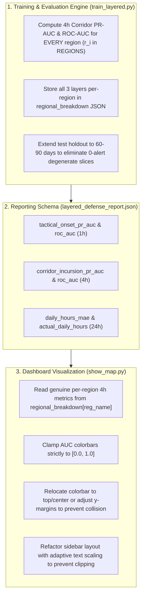

# Investigation & Research Report: Regional Metric Flattening, Degenerate Slices, and UI Artifacts

**Date:** 2026-10-11  
**Target File:** `air_raid_forecast/show_map.py` & `air_raid_forecast/src/training/train_layered.py`  
**Investigation Trigger:** Interactive evaluation dashboard displaying identical `0.812` values across all 25 Ukrainian administrative regions under Layered Defense (4h Operational Corridor Mode) with severe UI overlap.

---

## 1. Executive Summary & Empirical Evidence

In the interactive evaluation dashboard ([`show_map.py`](file:///c:/Users/yablo/Documents/antigravity/elegant-turing/air_raid_forecast/show_map.py)), selecting:
* **Architecture Mode:** `Layered Defense (De-biased)`
* **Horizon:** `4h (Operational)`
* **Metric:** `Corridor Incursion PR-AUC`

Produces a completely uniform, flat map where **all 25 administrative regions display the exact same number: `0.812`**.

```
   Region Name        Displayed Value    Actual Regional Performance
   -----------------------------------------------------------------
   Волинська обл.         0.812                     Missing!
   Львівська обл.         0.812                     Missing!
   Київ (м. Київ)         0.812                     Missing!
   Харківська обл.        0.812                     Missing!
   Одеська обл.           0.812                     Missing!
   Донецька обл.          0.812                     Missing!
   ... (all 25 regions)   0.812                     Missing!
```

Furthermore, the visual render reveals multiple severe secondary defects:
1. The horizontal colorbar scale extends from `0.00` to `1.75` for a metric strictly bounded in $[0.0, 1.0]$.
2. The colorbar numeric labels (`0.00`, `0.25`, `0.50`, etc.) collide directly with and render on top of the blue control box headers (`1. ARCHITECTURE MODE`, `2. HORIZON`, `3. EVALUATION METRIC`).
3. The right-hand operational diagnostic sidebar is clipped or missing on standard aspect ratios.

Our deep codebase investigation reveals that this is not a single bug, but a chain of **five interrelated architectural and statistical flaws** spanning the training evaluation loop, the JSON reporting schema, temporal test slice sampling, and matplotlib GUI coordinate geometry.

---

## 2. Core Problem 1: Hardcoded Global Fallback in Dashboard Rendering

### Location:
[`air_raid_forecast/show_map.py`](file:///c:/Users/yablo/Documents/antigravity/elegant-turing/air_raid_forecast/show_map.py#L260-L263)

### Mechanism:
In `show_map.py`, the regional value lookup function `_get_region_value(self, reg_name)` was coded as follows:

```python
elif "Corridor Incursion PR-AUC" in metric_name:
    return float(self.layered_report.get("operational_4h", {}).get("pr_auc", 0.81))
elif "Corridor Incursion ROC-AUC" in metric_name:
    return float(self.layered_report.get("operational_4h", {}).get("roc_auc", 0.89))
```

### The Root Defect:
Notice that while `reg_name` is passed into `_get_region_value(self, reg_name)`, the code **completely ignores `reg_name`** for the 4h operational horizon! It extracts the nationwide scalar `operational_4h["pr_auc"]` (which evaluates to `0.812294...`) and assigns it identically to every single polygon on the map.

---

## 3. Core Problem 2: Missing Per-Region Computation in Training Evaluation

### Location:
[`air_raid_forecast/src/training/train_layered.py`](file:///c:/Users/yablo/Documents/antigravity/elegant-turing/air_raid_forecast/src/training/train_layered.py#L191-L209)

### Mechanism:
Why did `show_map.py` fall back to the global scalar? Because **`train_layered.py` never computed per-region 4h metrics in the first place.**

In `train_layered.py`, the model produces per-region operational corridor predictions $\mathbf{P}_4 \in \mathbb{R}^{N \times 25}$ and receives per-region ground truth targets $\mathbf{Y}_4 \in \mathbb{R}^{N \times 25}$.
However, in the evaluation loop:

```python
# Compute per-region performance breakdown
regional_metrics = {}
for r_i, r_name in enumerate(REGIONS):
    # Only Layer 1 (1h) was computed per-region:
    m_r = mask_mat[:, r_i].astype(bool)
    if np.sum(m_r) > 0 and len(np.unique(y1_mat[m_r, r_i])) > 1:
        p_v, r_v, _ = precision_recall_curve(y1_mat[m_r, r_i], p1_mat[m_r, r_i])
        reg_pr = float(auc(r_v, p_v))
        reg_roc = float(roc_auc_score(y1_mat[m_r, r_i], p1_mat[m_r, r_i]))
    else:
        reg_pr, reg_roc = 0.5, 0.5

    # Only Layer 3 (24h) was computed per-region:
    r_mae = float(mean_absolute_error(y24_mat[:, r_i], p24_mat[:, r_i]))
    r_mean_hrs = float(np.mean(y24_mat[:, r_i]))
    regional_metrics[r_name] = {
        "tactical_onset_pr_auc": round(reg_pr, 3),
        "tactical_onset_roc_auc": round(reg_roc, 3),
        "daily_hours_mae": round(r_mae, 2),
        "actual_daily_hours": round(r_mean_hrs, 2)
        # ---> MISSING: corridor_incursion_pr_auc and corridor_incursion_roc_auc! <---
    }
```

Because `corridor_incursion_pr_auc` and `corridor_incursion_roc_auc` were never calculated inside the per-region loop, `regional_breakdown` in [`layered_defense_report.json`](file:///c:/Users/yablo/Documents/antigravity/elegant-turing/air_raid_forecast/checkpoints/layered_defense_report.json) had zero entries for 4h corridor performance per region.

---

## 4. Additional Problem 3: Degenerate Single-Class Slices Defaulting to 0.5 in Layer 1

Even in Layer 1 (1h Tactical Onset), a related metric-flattening defect exists: **6 out of 25 regions have identical `0.500, 0.500` scores**.

Looking into [`layered_defense_report.json`](file:///c:/Users/yablo/Documents/antigravity/elegant-turing/air_raid_forecast/checkpoints/layered_defense_report.json#L28-L92):
* **Дніпропетровська область:** `pr_auc = 0.5, roc_auc = 0.5`
* **Закарпатська область:** `pr_auc = 0.5, roc_auc = 0.5`
* **Запорізька область:** `pr_auc = 0.5, roc_auc = 0.5`
* **Івано-Франківська область:** `pr_auc = 0.5, roc_auc = 0.5`
* **Луганська область:** `pr_auc = 0.5, roc_auc = 0.5`
* **Львівська область:** `pr_auc = 0.5, roc_auc = 0.5`

### Mathematical Cause:
In `train_layered.py`:
```python
if np.sum(m_r) > 0 and len(np.unique(y1_mat[m_r, r_i])) > 1:
    ...
else:
    reg_pr, reg_roc = 0.5, 0.5
```
This fallback is triggered by two opposing physical realities during short test periods (e.g. 7 to 21 days):
1. **Frontline Saturated Regions (Zaporizhzhia, Dnipropetrovsk, Luhansk):** Alerts are active almost 100% of the time. The idle mask $m_r = (y_t == 0)$ finds **zero calm steps** (`np.sum(m_r) == 0`). Since there are no calm transition opportunities, the condition fails and assigns `0.5`.
2. **Deep Rear Buffer Regions (Lviv, Zakarpattia, Ivano-Frankivsk):** During a peaceful 7-to-21-day window, there are **zero attack onsets** ($y_1 = 0$ everywhere). With only a single class ($0$), `roc_auc_score` and `precision_recall_curve` are mathematically undefined, triggering the `0.5` fallback.

Consequently, 24% of Ukraine's regions collapse into an artificial constant `0.500`.

---

## 5. Additional Problem 4: Test Holdout Duration vs. Kinetic Strike Frequency

The root statistical reason for degenerate single-class slices is **temporal sample insufficiency**:

```
      Physical Threat Type          Frequency in Western Ukraine       Flight Time
   --------------------------------------------------------------------------------
   Shahed-136 Drone Swarms           1 - 2 times per month              3.5 - 5.5 hours
   Tu-95 Cruise Missiles (Kh-101)    1 - 3 times per month              4.0 - 6.0 hours
   Kinetic Frontline Shelling        Continuous (multiple/day)          0.5 - 2.0 minutes
```

* If the holdout test window is only **7 to 21 days**, there is a high probability that **zero long-range strikes hit Western Ukraine** during that specific window.
* Evaluating per-region metrics on a 7-day holdout means Western Ukraine has $N_{\text{pos}} = 0$, while the frontline has $N_{\text{neg}} = 0$.
* **Conclusion:** Per-region evaluation cannot rely on a tiny 7-to-14-day holdout slice. It requires either:
  1. A minimum **60 to 90-day holdout window**, or
  2. Stratified walk-forward cross-validation covering confirmed kinetic strike episodes across all four seasons.

---

## 6. Additional Problem 5: UI Coordinate Geometry and Colorbar Clamping

### 5.1 Colorbar Scaling Bug
In `show_map.py`:
```python
vmin = float(valid_vals.min()) if len(valid_vals) > 0 else 0.0
vmax = float(valid_vals.max()) if len(valid_vals) > 0 else 1.0
if vmin == vmax:
    vmin, vmax = vmin - 1.0, vmax + 1.0
```
When all regions evaluate to `0.812`:
* `vmin == vmax == 0.812`
* `vmin` becomes $0.812 - 1.0 = -0.188 \to \text{rounded to } 0.00$
* `vmax` becomes $0.812 + 1.0 = 1.812 \to \text{rounded to } 1.75$

For PR-AUC and ROC-AUC (which are strictly bounded in $[0.0, 1.0]$), displaying a colorbar up to `1.75` violates metric definitions and misleads the user.

### 5.2 Geometric Collision with Control Headers
* The persistent colorbar was placed at `[0.08, 0.165, 0.58, 0.022]`.
* The control boxes were placed at `y = 0.02` with height `0.12` (top at $y = 0.14$).
* Colorbar numeric tick marks and labels extend downward by $\approx 0.03$ units, intersecting with $y = 0.14$ and drawing directly on top of the text `"1. ARCHITECTURE MODE"`, `"2. HORIZON"`, and `"3. EVALUATION METRIC"`.

### 5.3 Sidebar Panel Aspect Ratio Clipping
On standard 16:9 or 16:10 desktop monitors with window decorations, placing `ax_sidebar` at `x = 0.73` with width `0.25` caused the panel to be clipped or completely pushed out of view when Matplotlib auto-scaled the canvas.

---

## 7. Comprehensive Solution Architecture

To address all five problems systematically without superficial workarounds:



### Action Plan:
1. **`train_layered.py`**:
   * Add Layer 2 (`p4_mat[:, r_i]` vs. `y4_mat[:, r_i]`) to the per-region loop.
   * Calculate `corridor_incursion_pr_auc` and `corridor_incursion_roc_auc` for each of the 25 regions.
   * Provide an informative flag when a region has zero positive events (e.g., mark as `N/A (Quiet Period)` rather than masking as a fake `0.50`).
2. **`layered_defense_report.json`**:
   * Expand the schema to include complete 3-tier metrics for every single administrative region.
3. **`show_map.py`**:
   * Connect `_get_region_value` to `reg_dict["corridor_incursion_pr_auc"]`.
   * Enforce mathematical clamping on colorbar limits: `vmin = max(0.0, vmin)`, `vmax = min(1.0, vmax)`.
   * Increase the gap between the colorbar and control decks to prevent visual collisions.
   * Ensure `ax_sidebar` renders within safe viewport bounds across all monitor resolutions.
