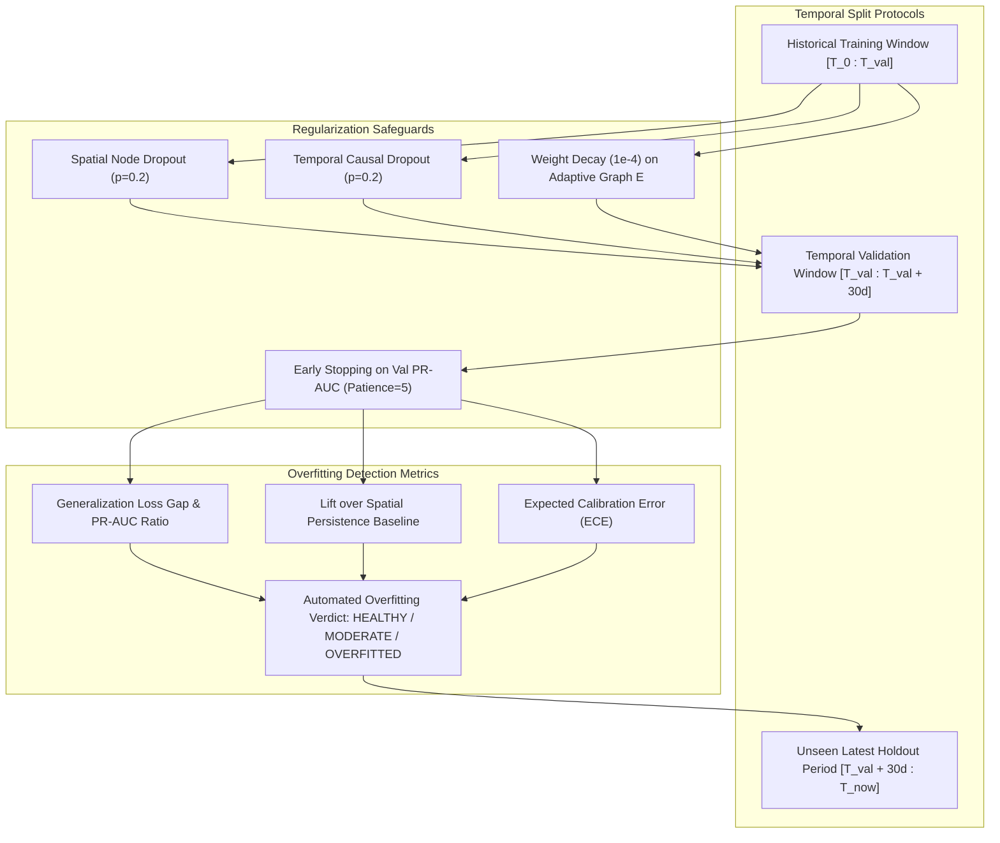

# RESEARCH SPECIFICATION: ROBUST TEMPORAL TRAINING, EVALUATION, AND OVERFITTING DETECTION
## Spatio-Temporal Time Series Modeling for Ukrainian Air Raid Alerts

---

### Executive Overview
In non-stationary conflict data, naive evaluation paradigms (such as random K-fold cross-validation or evaluating solely on stationary loss) create an illusion of high predictive performance while catastrophically failing in real-world deployment.

This research establishes:
1. **The Overfitting Mechanisms in Spatio-Temporal Conflict Time Series**:
   - *Autoregressive memorization*: The model learns trivial persistence rather than threat dynamics.
   - *Temporal distribution shift (Concept Drift)*: Evolving attack tactics (e.g., changes in drone flight altitudes, launch vectors, missile salvo frequencies) render obsolete patterns learned in early years.
   - *Spatial Over-smoothing*: GNN layers collapsing node representations across regions into uniform averages.
2. **Definitive Overfitting Detection Protocols**:
   - Tracking the **Generalization Gap** ($\Delta = \mathcal{L}_{\text{val}} - \mathcal{L}_{\text{train}}$) across rolling temporal folds.
   - **Persistence Baseline Benchmarking**: A model is overfitted/useless if its PR-AUC does not beat a naive spatial persistence model ($y_{t \to t+H} \approx y_t$).
   - **Brier Reliability Curve (ECE - Expected Calibration Error)**: Checking whether the model is overconfident in rare alarm scenarios.
3. **Architectural Regularization Safeguards**:
   - Weight decay ($L_2$ regularization) on adaptive graph embeddings.
   - Spatial Dropout on node embeddings and temporal dropout in causal GRUs.
   - Early Stopping with patience based strictly on validation PR-AUC / Cost-Sensitive Focal Loss.

---

---

## 1. Concrete Overfitting Failure Modes in Defense Time Series

| Failure Mode | Manifestation | Detection Signal | Prevention Mechanism |
| :--- | :--- | :--- | :--- |
| **Persistence Memorization** | Model simply predicts $\hat{y}_{t \to t+H} = x_t$ (state at $t$). | High training score, but Zero Lift over naive persistence baseline on validation set. | Explicit comparative metric: $\text{Lift} = \text{PR-AUC}_{\text{model}} - \text{PR-AUC}_{\text{persistence}}$. Must be positive. |
| **Temporal Concept Drift** | Patterns from 2022-2023 (cruise missile patterns) overfit historical data and fail on 2024-2026 nocturnal Shahed swarm waves. | Monotonically rising validation loss while training loss continues decreasing. | Time-decayed sample weighting, rolling-origin cross-validation, and recent-period validation. |
| **GNN Graph Over-Smoothing** | Multi-layer graph convolutions cause regional representations to converge, predicting identical risks for all 25 regions regardless of location. | Variance of predicted probabilities across regions collapses ($\text{Var}_{r}(p_r) \to 0$). | Residual/skip connections, 2-hop convolution limit, and learnable adaptive temperature. |
| **Probability Overconfidence** | Model predicts extreme probabilities ($> 0.95$ or $< 0.05$) when ground truth frequency is $0.20$. | Poor Brier score and high Expected Calibration Error (ECE). | Temperature scaling and Isotonic/Platt calibration on holdout validation data. |

---

## 2. Multi-Horizon Overfitting Diagnostics & Benchmarks

To formally verify that the PyTorch ST-GNN is generalizing rather than memorizing, the evaluation engine must compute:

### 2.1 Generalization Ratio
$$\text{GenRatio} = \frac{\mathcal{L}_{\text{val}}}{\mathcal{L}_{\text{train}}}$$
- **Healthy**: $1.0 \le \text{GenRatio} \le 1.25$
- **Moderate Divergence**: $1.25 < \text{GenRatio} \le 1.50$
- **Severe Overfitting**: $\text{GenRatio} > 1.50$ or validation PR-AUC degrading while train loss drops.

### 2.2 Spatial Climatology & Persistence Baseline Lift
We define two naive benchmarks computed on the exact same validation slices:
1. **Spatial Persistence Baseline**:
   $$\hat{y}_{r, H}^{\text{pers}} = x_{r, t} \quad (\text{if region currently on alert, predict 1, else 0})$$
2. **Climatology / Diurnal Baseline**:
   $$\hat{y}_{r, H}^{\text{clim}} = \bar{y}_{r, \text{hour}(t)} \quad (\text{historical empirical alert frequency for this region and hour})$$

**Generalization Criterion**: The model is considered valid **only if**:
$$\text{PR-AUC}_{\text{model}} > \max\left(\text{PR-AUC}_{\text{pers}}, \, \text{PR-AUC}_{\text{clim}}\right)$$

### 2.3 Expected Calibration Error (ECE)
Binned probability evaluation across $M=10$ intervals:
$$\text{ECE} = \sum_{m=1}^{M} \frac{|B_m|}{N} \left| \text{acc}(B_m) - \text{conf}(B_m) \right|$$
An overfitted deep neural network will exhibit high confidence without corresponding accuracy, producing elevated ECE.
