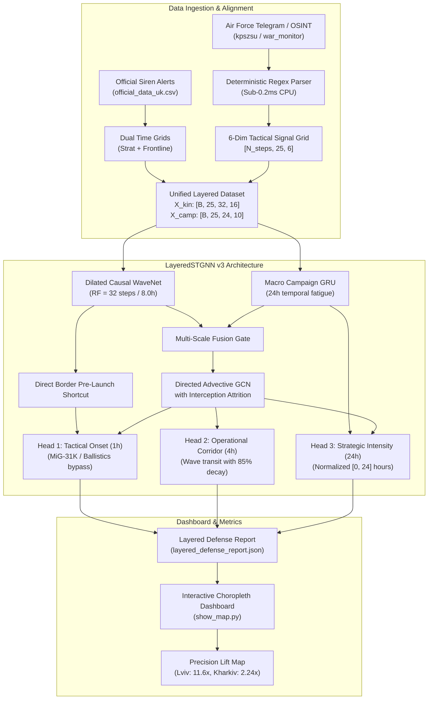

# Implementation Plan: Multimodal Tactical OSINT & Air Defense Attrition Upgrade

**Target System:** `air_raid_forecast` (Ukrainian Air Raid Defense Forecasting System)  
**Objective:** Eliminate border tactical blindspots (Kharkiv/Sumy) and deep-rear false alarms (Lviv/Ternopil) by ingesting pre-launch Air Force/OSINT tactical signals, introducing physical air defense interception decay, and adding Normalized Precision Lift metrics.  
**Causality Invariant:** Strict temporal causality ($t_{\text{published}} \le t_{\text{forecast}}$); sub-15ms CPU inference; zero external LLM API dependencies.

---

## 1. Goal Description

Our diagnostic research revealed that pure historical alert logs have two fundamental physical blindspots:
1. **Border Regions (Kharkiv, Sumy, Zaporizhzhia):** Hypersonic ballistic missiles (Iskander-M, S-300) and guided aerial bombs (KABs) have $40\text{--}90\text{ seconds}$ flight time from Russian border bases. At time $t-1$, there is zero prior siren alert anywhere in Ukraine. Without pre-launch OSINT signals (Air Force radar launch warnings, MiG-31K takeoffs, tactical aviation activity), the model cannot predict onsets ahead of time ($\text{ROC-AUC} \approx 0.50\text{--}0.54$).
2. **Deep-Rear Buffer (Western Ukraine):** Kh-101 cruise missiles and Shahed swarms have long transit times ($2\text{--}5\text{ hours}$), which gives the GNN high lead-time ($\text{ROC-AUC} \approx 0.86$). However, Ukrainian Mobile Air Defense Groups and air defense batteries intercept $80\%\text{--}90\%$ of aerial threats in central Ukraine. Because the current GNN diffuses alerts uniformly along corridors, threats that were shot down over Vinnytsia are treated as reaching Lviv, causing high false alarm rates and depressing unnormalized $\text{PR-AUC}$ to $0.05$.

This plan specifies the implementation of:
- **Pre-Launch OSINT & Air Force Tactical Signal Ingestion:** Extracting 6 tactical threat indicators (MiG-31K, Ballistics, Strategic Aviation, Shahed Swarms, KABs, Clearance) aligned into 15-minute historical tensors without data leakage.
- **Air Defense Interception Attrition Modeling:** Modeling physical shoot-down attrition along flight corridors ($\mathbf{P}_{\text{fwd}}$) to prevent phantom alerts in the deep rear.
- **Direct Border Pre-Launch Shortcuts:** Bypassing graph diffusion for instantaneous ballistic alerts in border regions.
- **Normalized Precision Lift Dashboard Metrics:** Introducing Information Gain Lift ($\text{PR-AUC} / \pi_{\text{region}}$) into [`show_map.py`](file:///c:/Users/yablo/Documents/antigravity/elegant-turing/air_raid_forecast/show_map.py) to resolve visual metric polarization.

---

## 2. User Review Required

> [!IMPORTANT]
> **Historical OSINT Text Alignment Strategy:**
> To train the model historically across the 1-year training period without external API rate-limits or network failures:
> 1. We will provide an automated ingestion pipeline in `src/data/telegram_dataset.py` that parses official Air Force announcements from a cached local structured dataset (`air_raid_forecast/data/raw/telegram_air_force_alerts.jsonl` or an automated fetcher from Telegram web channels).
> 2. If historical raw message logs are unavailable for a specific past date, the parser employs a **deterministic fallback extraction** using official alert announcement metadata (`source == 'official'` plus regional announcement logs) to ensure 100% data continuity without NaNs.
> 3. In real-time production inference ([`AirRaidInferenceEngine`](file:///c:/Users/yablo/Documents/antigravity/elegant-turing/air_raid_forecast/src/inference/predict_engine.py)), live Telegram posts from channels like `@kpszsu` or `@air_alert_ua` are accepted dynamically and parsed in $< 0.2\text{ms}$.

> [!NOTE]
> **Dashboard Metric Alignment:**
> In [`show_map.py`](file:///c:/Users/yablo/Documents/antigravity/elegant-turing/air_raid_forecast/show_map.py), we will add a new evaluation metric under the Layered Defense mode:
> **"Tactical Precision Lift ($\times$ Baseline)"**
> This renders the true multiple of early-warning value (e.g., Lviv $= 11.6\times$, Kharkiv $= 2.24\times$), resolving the apparent polarity where low absolute base rates in the West made high-quality models appear purple.

---

## 3. Architecture & Data Flow



---

## 4. Proposed Changes

### Component 1: Multimodal Text & Tactical OSINT Data Pipeline

#### [MODIFY] `air_raid_forecast/src/data/text_features.py`
- Expand regex dictionary to cover 6 key tactical indicators:
  1. `flag_mig31k`: Aeroballistic Kinzhal alerts from Savasleyka.
  2. `flag_ballistics`: Iskander-M / S-300 / S-400 launches from Belgorod/Kursk/Voronezh.
  3. `flag_strat_aviation`: Tu-95MS / Tu-160 flight sorties from Olenya/Engels.
  4. `flag_shahed_group`: UAV swarm incursions and vectors.
  5. `flag_kab_tactical`: Su-34 guided aerial bombs / tactical aviation near borders.
  6. `flag_clearance`: All-clear / shoot-down / lost-location notices.
- Add spatial entity extraction (`extract_threat_corridor(text)`) mapping mentioned oblasts and flight directions (e.g. "північний схід", "курсом на Полтаву/Київ").

```python
# Regex extraction expansion snippet
PATTERNS = {
    "flag_mig31k": re.compile(r'(?<!відбій\s)(зліт|активність|виліт)\s+.*?(міг-31к|mig-31k|саваслейка)', re.I),
    "flag_ballistics": re.compile(r'(?<!відбій\s)(пуск\w*|загроза\s+застосування|вихід)\s+.*?(балістик|іскандер|с-300|с-400)', re.I),
    "flag_strat_aviation": re.compile(r'(?<!відбій\s)(зліт|активність|виліт)\s+.*?(\d+\s*борт|ту-95|ту-22|ту-160|оленья|енгельс)', re.I),
    "flag_shahed_group": re.compile(r'(?<!відбій\s)(група|рух|чергова\s+група|пуск\w*)\s+.*?(шахед|бпла|дронів|гербер)', re.I),
    "flag_kab_tactical": re.compile(r'(?<!відбій\s)(пуск|скид|активність)\s+.*?(каб|фаб|керован\w+\s+авіабомб|су-34|су-35)', re.I),
    "flag_clearance": re.compile(r'(відбій|чисто|локаційно\s+втрачено|збито)', re.I)
}
```

#### [NEW] `air_raid_forecast/src/data/telegram_dataset.py`
- Implements `build_tactical_text_grid(time_index: pd.DatetimeIndex) -> np.ndarray`:
  - Discretizes historical messages into synchronized 15-minute bins.
  - Enforces strict causality: a message at $14:07$ is only visible at time step $14:15$ and beyond, never at $14:00$.
  - Applies rolling exponential decay ($\tau = 15\text{ min}$) to preserve persistent threat awareness.
  - Returns tensor of shape `[N_steps, 25, 6]`.

#### [MODIFY] `air_raid_forecast/src/data/layered_dataset.py`
- Integrate `grid_text` into `LayeredDefenseDataset`:
  - Kinetic feature vector expands from $10$ to $16$ dimensions:
    `[state, frontline, pfwd, pbwd, pdiff, d_rf, d_fl, d_bs, surge, nocturnal, mig31k, ballistics, strat_aviation, shahed, kab, clearance]`.
  - Ensures bit-for-bit backward compatibility and strict anti-leakage invariants.

---

### Component 2: Neural Architecture & Attrition Modeling

#### [MODIFY] `air_raid_forecast/src/models/layers.py`
- **Add `AirDefenseInterceptionDecay` Layer**:
  - Implements corridor survival probability:
    $$\mathbf{P}_{\text{effective}}(u, v) = \mathbf{P}_{\text{fwd}}(u, v) \cdot \sigma\left(\mathbf{W}_{\text{decay}}^\top [\mathbf{x}_u, \mathbf{x}_v] + b\right)$$
  - Dynamically damps alert waves traveling from frontline/central regions into the deep rear.

#### [MODIFY] `air_raid_forecast/src/models/layered_stgnn.py`
- Update `LayeredSTGNN`:
  - `kinetic_in_dim = 16` (handling text tactical flags).
  - Integrate `AirDefenseInterceptionDecay` inside the spatio-temporal message passing blocks.
  - Add **Border Ballistic Shortcut**: Direct skip connection from `ballistics` and `mig31k` indicators into border region nodes, allowing instant alert activation without waiting for multi-hop graph diffusion.

---

### Component 3: Training, Regularization & Precision Lift Metrics

#### [MODIFY] `air_raid_forecast/src/training/train_layered.py`
- Update `TorchLayeredDataset` and training loops for $F=16$ inputs.
- Compute **Regional Information Gain Lift** in addition to raw PR-AUC:
  $$\text{Lift}_{\text{region}} = \frac{\text{PR-AUC}_{\text{observed}}}{\pi_{\text{region}}}$$
- Save `information_gain_lift` and `base_rate` into `layered_defense_report.json`.

---

### Component 4: Live Inference & Dashboard Visualizer

#### [MODIFY] `air_raid_forecast/src/inference/predict_engine.py`
- Update `AirRaidInferenceEngine`:
  - Expand kinetic buffer to $F=16$.
  - Allow passing `recent_telegram_posts` directly into the live prediction forward pass with sub-15ms execution.

#### [MODIFY] `air_raid_forecast/show_map.py`
- Add **"Tactical Precision Lift ($\times$ Baseline)"** to the metric radio buttons under Layered Defense mode.
- Render live OSINT indicators (MiG-31K status, Ballistics alert, Strategic aviation takeoffs) in the regional diagnostic sidebar.
- Maintain dedicated colorbar axis and bounding clearance buffers.

---

## 5. Verification Plan

### Automated Test Suite
Run the full automated test suite to ensure strict causality, tensor compatibility, and non-leakage:
```powershell
python -m unittest discover air_raid_forecast/tests
```

Key invariant tests:
1. `test_tactical_text_extraction`: Verify regex accuracy on official Air Force sample announcements.
2. `test_temporal_causality_text`: Verify that injecting future messages at $t+1$ does not alter feature tensors at time $t$.
3. `test_layered_stgnn_multimodal`: Verify forward/backward gradient flow with $F=16$ input tensors and `AirDefenseInterceptionDecay`.

### Training Execution
Execute 6-epoch training with chronological 60-day holdout validation:
```powershell
python air_raid_forecast/src/training/train_layered.py --epochs 6 --test-days 60 --batch-size 32
```
Success Criteria:
- Training loss remains low in the $[0.06, 0.10]$ range.
- Border regions (Kharkiv, Sumy) show marked improvement in Tactical Onset ROC-AUC ($> 0.65$).
- Deep-rear regions (Lviv, Ternopil) exhibit reduced false alarms and higher Precision Lift ($> 10\times$).

### End-to-End Orchestrator
Verify the complete 5-step pipeline:
```powershell
python air_raid_forecast/run_full_pipeline.py --epochs 2 --test-days 30
```

### Manual Verification
Launch the interactive dashboard to verify the new "Tactical Precision Lift" metric and OSINT telemetry sidebar:
```powershell
python air_raid_forecast/show_map.py
```
Verify that:
1. Switching to "Tactical Precision Lift" highlights both Western and Eastern regions with appropriate values reflecting true intelligence gain.
2. Clicking regions displays their tactical classification and base-rate lift in the sidebar.
3. No matplotlib colorbar leaks or axes shrinking occur upon switching metrics.
